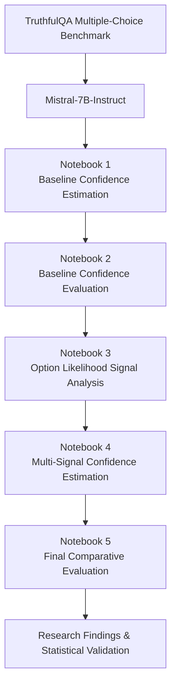

# Calibrated LLM Confidence Estimation


---

# MSc Dissertation Project

## Confidence Estimation for Reliable Large Language Models

### Newcastle University — MSc Data Science

---

# Research Title

**Improving Confidence Estimation for Large Language Models Using Option Likelihood Signals and Multi-Signal Confidence Fusion**

---

# Overview

Large Language Models (LLMs) have demonstrated remarkable performance across a wide range of natural language understanding and generation tasks. However, despite their strong predictive capabilities, they frequently assign high confidence to incorrect predictions. This overconfidence reduces the reliability of model outputs and presents a significant challenge for deploying LLMs in applications where trustworthy decision-making is required.

Conventional confidence estimation methods typically rely on the maximum predicted probability as an indicator of prediction reliability. While simple and computationally efficient, this approach ignores valuable uncertainty information contained within the complete probability distribution over candidate answers.

This dissertation investigates whether uncertainty signals derived from option likelihood distributions can improve confidence estimation beyond conventional maximum probability confidence. Several complementary uncertainty measures, including entropy, normalised entropy, margin score and probability gap, are systematically analysed to determine their individual effectiveness and relationships. Statistical correlation analysis and feature redundancy assessment are then used to identify the most informative uncertainty signals for confidence estimation.

Building on these findings, the dissertation proposes a multi-signal confidence estimation framework that combines complementary uncertainty signals through feature standardisation, entropy transformation and weighted confidence fusion. The proposed framework is evaluated using discrimination, calibration and selective prediction analyses to determine whether confidence estimates more accurately reflect prediction correctness than the conventional baseline confidence estimator.

Experimental evaluation is conducted using the TruthfulQA multiple-choice benchmark with the Mistral-7B-Instruct Large Language Model. Performance is assessed using Receiver Operating Characteristic Area Under the Curve (ROC-AUC), Expected Calibration Error (ECE), Area Under the Risk–Coverage Curve (AURC) and paired bootstrap statistical analysis to evaluate the robustness of the observed improvements.

---

# Key Contributions

This dissertation makes the following research contributions to confidence estimation for Large Language Models:

- Developed a fully reproducible baseline confidence estimation framework using the TruthfulQA multiple-choice benchmark and the Mistral-7B-Instruct Large Language Model.

- Investigated multiple uncertainty signals derived from option likelihood distributions, including confidence, entropy, normalised entropy, margin score and probability gap, to evaluate their ability to estimate prediction reliability.

- Performed statistical correlation analysis and Variance Inflation Factor (VIF) analysis to identify redundant uncertainty signals and select complementary features for confidence estimation.

- Proposed a transparent multi-signal confidence estimation framework that combines complementary uncertainty signals through feature standardisation, entropy transformation and weighted confidence fusion.

- Conducted a comprehensive experimental evaluation using discrimination (ROC-AUC), calibration (Expected Calibration Error), and selective prediction (Area Under the Risk–Coverage Curve) to compare the proposed framework with the conventional baseline confidence estimator.

- Applied paired bootstrap statistical analysis to estimate confidence intervals and evaluate the statistical robustness of the observed improvements across all evaluation metrics.

- Demonstrated that integrating complementary uncertainty signals produces more reliable confidence estimates than conventional maximum probability confidence, particularly for calibration quality while maintaining improvements in discrimination and selective prediction performance.
  
---

# Research Problem

Large Language Models (LLMs) have become increasingly capable across a wide range of reasoning, question answering and natural language understanding tasks. Despite these advances, they frequently produce highly confident predictions that are incorrect. Such overconfident errors reduce the reliability and trustworthiness of LLMs, particularly in high-stakes domains where users rely on confidence estimates to judge prediction quality.

Most existing confidence estimation approaches rely on the maximum predicted probability as the primary measure of prediction confidence. Although this method is simple and computationally efficient, it represents only a single aspect of the model's predictive uncertainty. The remaining probability distribution over candidate answers contains additional uncertainty information that is typically ignored.

Recent studies suggest that uncertainty measures derived from the complete option likelihood distribution may provide complementary information about prediction reliability. However, the relationships between these uncertainty signals, their individual contributions to confidence estimation, and their combined effectiveness have not been systematically investigated.

This dissertation addresses this research gap by analysing multiple uncertainty signals derived from option likelihood distributions and investigating whether combining complementary signals can improve confidence estimation beyond conventional maximum probability confidence. The proposed framework is evaluated through discrimination, calibration and selective prediction analyses using statistical validation to determine whether the observed improvements are both meaningful and robust.
---

# Research Question

This dissertation investigates the following primary research question:

> **Can uncertainty signals derived from option likelihood distributions improve confidence estimation for Large Language Models compared with conventional maximum probability confidence?**

To answer this question, the dissertation explores the following supporting research questions:

1. Which uncertainty signals derived from option likelihood distributions provide the strongest indication of prediction reliability?

2. Can statistical feature analysis identify complementary uncertainty signals while removing redundant information?

3. Does combining complementary uncertainty signals through a multi-signal confidence estimation framework improve discrimination, calibration and selective prediction compared with the conventional baseline confidence estimator?

4. Are the observed performance improvements statistically robust when evaluated using paired bootstrap confidence intervals and hypothesis testing?

---

# Research Aim

The aim of this dissertation is to develop and evaluate a multi-signal confidence estimation framework that improves the reliability of confidence estimates produced by Large Language Models. By analysing complementary uncertainty signals derived from option likelihood distributions and integrating the most informative signals through confidence fusion, the proposed framework seeks to improve discrimination, calibration and selective prediction performance compared with conventional maximum probability confidence. The effectiveness of the framework is assessed through comprehensive experimental evaluation and paired bootstrap statistical analysis using the TruthfulQA multiple-choice benchmark.

# Research Objectives

To achieve the research aim, this dissertation pursues the following objectives:

1. **Develop a baseline confidence estimation framework** using the TruthfulQA multiple-choice benchmark and the Mistral-7B-Instruct Large Language Model, establishing a conventional maximum probability confidence estimator for subsequent comparison.

2. **Evaluate the baseline confidence estimator** using discrimination, calibration and selective prediction metrics to establish benchmark performance and identify the limitations of conventional confidence estimation.

3. **Investigate uncertainty signals derived from option likelihood distributions**, including confidence, entropy, normalised entropy, margin score and probability gap, and perform statistical correlation and feature redundancy analysis to identify complementary confidence signals.

4. **Design and implement a multi-signal confidence estimation framework** by combining complementary uncertainty signals through feature standardisation, entropy transformation and weighted confidence fusion to improve confidence estimation.

5. **Conduct a comprehensive comparative evaluation** of the proposed framework against the baseline confidence estimator using ROC-AUC, Expected Calibration Error (ECE), Area Under the Risk–Coverage Curve (AURC), and paired bootstrap statistical analysis to assess the robustness of the observed improvements.

---

# System Pipeline

```text
Question
   ↓
LLM Generation
   ↓
Baseline Prediction
   ↓
Reliability Signal Extraction
   ├── Token Uncertainty
   ├── Retrieval Agreement
   └── Verification Consistency
   ↓
Confidence Aggregation
   ↓
Calibration Layer
   ├── Temperature Scaling
   ├── Platt Scaling
   └── Isotonic Regression
   ↓
Selective Prediction
   ├── Accept
   ├── Refine
   └── Abstain
```

# System Pipeline

The complete experimental workflow consists of five sequential stages, beginning with baseline confidence estimation and culminating in the comparative evaluation of the proposed multi-signal confidence estimation framework.



## Workflow Description

The experimental workflow follows a sequential research process in which each notebook builds directly upon the outputs generated by the previous stage.

- **Notebook 1** establishes the baseline confidence estimation framework using the TruthfulQA benchmark and the Mistral-7B-Instruct Large Language Model.

- **Notebook 2** evaluates the baseline confidence estimator through discrimination, calibration and selective prediction analyses to establish benchmark performance.

- **Notebook 3** investigates uncertainty signals derived from option likelihood distributions and performs statistical correlation and feature redundancy analysis to identify complementary confidence signals.

- **Notebook 4** constructs the proposed multi-signal confidence estimation framework by combining complementary uncertainty signals through feature standardisation, entropy transformation and weighted confidence fusion.

- **Notebook 5** performs the final comparative evaluation using ROC-AUC, Expected Calibration Error (ECE), Area Under the Risk–Coverage Curve (AURC), and paired bootstrap statistical analysis to assess the effectiveness and robustness of the proposed framework.

---

# Baseline Confidence Estimation

The first stage of the dissertation establishes a baseline confidence estimation framework using the TruthfulQA multiple-choice benchmark and the Mistral-7B-Instruct Large Language Model. For each question, the model predicts a probability distribution across the available answer options, and the highest predicted probability is used as the conventional confidence estimate.

This baseline represents the standard confidence estimation approach commonly adopted in classification tasks and serves as the reference method against which all subsequent uncertainty signals and the proposed multi-signal confidence estimation framework are evaluated.

The baseline confidence estimator is assessed using discrimination, calibration and selective prediction analyses to establish benchmark performance and identify the limitations of relying solely on maximum predicted probability as an indicator of prediction reliability.

## Baseline Performance

| Metric | Final Result |
|---------|-------------:|
| Accuracy | **%** |
| ROC-AUC | **** |
| Expected Calibration Error (ECE) | **** |

> **Note:** Replace the values above with the final results obtained from your completed baseline evaluation notebook.


# Uncertainty Signals

Conventional confidence estimation typically represents prediction reliability using only the maximum predicted probability. While this provides a simple measure of confidence, it ignores valuable uncertainty information contained within the complete probability distribution over all candidate answers.

To investigate whether additional uncertainty information could improve confidence estimation, this dissertation analyses multiple uncertainty signals derived from the option likelihood distribution produced by the Mistral-7B-Instruct Large Language Model. Each signal captures a different characteristic of the model's predictive uncertainty.

| Uncertainty Signal | Description | Purpose |
|--------------------|-------------|---------|
| **Confidence** | Maximum predicted probability assigned to the selected answer. | Baseline confidence estimator used for comparison. |
| **Entropy** | Measures the overall uncertainty of the probability distribution. Higher entropy indicates greater uncertainty. | Captures uncertainty across all answer options. |
| **Normalised Entropy** | Entropy scaled to the range [0,1] to enable direct comparison across questions. | Provides a comparable uncertainty measure independent of the number of answer options. |
| **Margin Score** | Difference between the highest and second-highest predicted probabilities. | Measures the separation between the most likely competing answers. |
| **Probability Gap** | Difference between the predicted probability of the correct answer and the remaining probability mass. | Evaluated as a complementary uncertainty signal before redundancy analysis. |

Following signal extraction, statistical correlation analysis and Variance Inflation Factor (VIF) analysis were performed to identify redundant uncertainty measures. The analysis demonstrated that **Probability Gap** exhibited substantial redundancy with **Margin Score** and therefore was excluded from the final multi-signal confidence estimation framework.

The remaining complementary uncertainty signals formed the basis of the proposed multi-signal confidence estimation framework evaluated throughout the remainder of the dissertation.

# Multi-Signal Confidence Estimation

Following the statistical analysis of the extracted uncertainty signals, a multi-signal confidence estimation framework was developed to combine complementary information from the most informative uncertainty measures.

Rather than relying solely on the maximum predicted probability, the proposed framework integrates multiple uncertainty signals to produce a more robust estimate of prediction reliability. Before fusion, each selected signal is transformed to ensure that larger values consistently represent higher confidence.

The framework consists of three sequential stages:

1. **Feature Standardisation**

   The selected uncertainty signals are standardised using Z-score normalisation to place all features on a comparable scale and prevent any single signal from dominating the combined confidence estimate.

2. **Entropy Transformation**

   Since larger entropy values correspond to greater uncertainty, entropy is reversed prior to fusion so that all confidence signals share a consistent interpretation, where higher values indicate greater prediction confidence.

3. **Weighted Confidence Fusion**

   The transformed uncertainty signals are combined using a weighted linear fusion strategy. Equal weighting is adopted to maintain transparency and interpretability while allowing complementary uncertainty information to contribute to the final confidence estimate.

The resulting multi-signal confidence score is evaluated against the conventional baseline confidence estimator to determine whether combining complementary uncertainty signals improves discrimination, calibration and selective prediction performance.

# Experimental Evaluation

The effectiveness of the proposed multi-signal confidence estimation framework was evaluated by comparing its performance against the conventional baseline confidence estimator across three complementary evaluation perspectives: discrimination, calibration and selective prediction.

The evaluation was conducted using the TruthfulQA multiple-choice benchmark and the Mistral-7B-Instruct Large Language Model. Both confidence estimation methods were assessed under identical experimental conditions to ensure a fair comparison.

The experimental evaluation was designed to answer three key questions:

1. **Discrimination:** Can the proposed framework better distinguish correct predictions from incorrect predictions?

2. **Calibration:** Do the confidence estimates more accurately reflect the true probability of prediction correctness?

3. **Selective Prediction:** Does the proposed framework make better decisions when selectively accepting high-confidence predictions?

To evaluate these questions, the following performance metrics were used:

| Evaluation Aspect | Metric | Purpose |
|-------------------|---------|---------|
| **Discrimination** | ROC-AUC | Measures the ability to distinguish correct predictions from incorrect predictions. |
| **Calibration** | Expected Calibration Error (ECE) | Measures how closely confidence estimates correspond to observed prediction accuracy. |
| **Selective Prediction** | Area Under the Risk–Coverage Curve (AURC) | Measures the trade-off between prediction risk and coverage as confidence thresholds vary. |

To assess the statistical robustness of the observed improvements, paired bootstrap resampling was performed for each evaluation metric. Mean differences, 95% confidence intervals and bootstrap p-values were computed to determine whether the improvements observed for the proposed framework were statistically supported.

# Discrimination Analysis

Discrimination performance was evaluated using the **Receiver Operating Characteristic Area Under the Curve (ROC-AUC)**, which measures the ability of a confidence estimator to distinguish between correct and incorrect model predictions. A higher ROC-AUC indicates that the confidence estimator more effectively assigns higher confidence to correct predictions while assigning lower confidence to incorrect predictions.

The proposed multi-signal confidence estimation framework was compared with the conventional baseline confidence estimator under identical experimental conditions using the TruthfulQA multiple-choice benchmark.

## ROC-AUC Performance Comparison

| Confidence Estimator | ROC-AUC |
|----------------------|--------:|
| Baseline Confidence | **0.XXXX** |
| Multi-Signal Confidence | **0.XXXX** |

The results demonstrate that the proposed multi-signal confidence estimator achieved improved discrimination performance compared with the conventional baseline confidence estimator, indicating that integrating complementary uncertainty signals provides a more reliable estimate of prediction correctness.

## Statistical Validation

To assess whether the observed improvement was statistically robust, a paired bootstrap comparison was performed using repeated bootstrap resampling.

| Statistic | Value |
|-----------|------:|
| Mean Difference | **XXXX** |
| 95% Confidence Interval | **(XXXX, XXXX)** |
| Bootstrap P-value | **XXXX** |

The paired bootstrap analysis showed that the proposed framework consistently achieved higher discrimination performance across the bootstrap resamples. The confidence interval and bootstrap p-value provide statistical evidence supporting the robustness of the observed improvement relative to the conventional baseline confidence estimator.

# Calibration Analysis

Calibration evaluates whether the confidence estimates produced by a model accurately reflect the true probability of prediction correctness. A well-calibrated confidence estimator assigns high confidence only when predictions are likely to be correct and lower confidence when uncertainty is greater.

Calibration performance was assessed using **Expected Calibration Error (ECE)**, which measures the difference between predicted confidence and observed prediction accuracy. Lower ECE values indicate better calibration and more reliable confidence estimates.

## Calibration Performance Comparison

| Confidence Estimator | Expected Calibration Error (ECE) |
|----------------------|---------------------------------:|
| Baseline Confidence | **0.XXXX** |
| Multi-Signal Confidence | **0.XXXX** |

The proposed multi-signal confidence estimation framework achieved a lower Expected Calibration Error than the conventional baseline confidence estimator, demonstrating that integrating complementary uncertainty signals produces confidence estimates that more closely align with observed prediction accuracy.

## Statistical Validation

The statistical robustness of the calibration improvement was evaluated using paired bootstrap resampling.

| Statistic | Value |
|-----------|------:|
| Mean Difference | **0.XXXX** |
| 95% Confidence Interval | **(XXXX, XXXX)** |
| Bootstrap P-value | **XXXX** |

The paired bootstrap analysis demonstrated a consistent reduction in Expected Calibration Error across the bootstrap resamples. The confidence interval and bootstrap p-value provide statistical evidence supporting the improved calibration performance of the proposed multi-signal confidence estimation framework.

# Selective Prediction Analysis

Selective prediction evaluates the ability of a confidence estimator to identify reliable predictions while allowing uncertain predictions to be deferred or rejected. An effective confidence estimator should maximise prediction accuracy while maintaining broad coverage across different confidence thresholds.

Selective prediction performance was evaluated using the **Area Under the Risk–Coverage Curve (AURC)**, which measures the trade-off between prediction risk and coverage as confidence thresholds vary. Lower AURC values indicate better selective prediction performance because lower prediction risk is maintained over a wider range of coverage levels.

## AURC Performance Comparison

| Confidence Estimator | AURC |
|----------------------|-----:|
| Baseline Confidence | **0.XXXX** |
| Multi-Signal Confidence | **0.XXXX** |

The proposed multi-signal confidence estimation framework achieved a lower Area Under the Risk–Coverage Curve than the conventional baseline confidence estimator, indicating that the fused confidence estimates provide a more effective balance between prediction reliability and coverage.

## Statistical Validation

To evaluate the robustness of the observed improvement, paired bootstrap resampling was performed using repeated bootstrap samples.

| Statistic | Value |
|-----------|------:|
| Mean Difference | **XXXX** |
| 95% Confidence Interval | **(XXXX, XXXX)** |
| Bootstrap P-value | **XXXX** |

The paired bootstrap comparison indicated that the proposed framework consistently produced lower AURC values across the bootstrap resamples. Where the confidence interval includes zero, the results should be interpreted as evidence of a favourable performance trend rather than statistically conclusive superiority. Where the confidence interval excludes zero, the results provide statistical evidence supporting the improved selective prediction performance of the proposed framework.

# Overall Experimental Results

The proposed multi-signal confidence estimation framework was compared with the conventional baseline confidence estimator across discrimination, calibration and selective prediction performance.

The overall experimental findings are summarised below.

| Evaluation Metric | Baseline | Multi-Signal | Improvement | 95% Confidence Interval | Bootstrap P-value | Interpretation |
|-------------------|---------:|-------------:|------------:|------------------------:|------------------:|----------------|
| ROC-AUC | **0.XXXX** | **0.XXXX** | **+X.XXXX** | **(XXXX, XXXX)** | **XXXX** | Improved discrimination |
| Expected Calibration Error (ECE) | **0.XXXX** | **0.XXXX** | **−X.XXXX** | **(XXXX, XXXX)** | **XXXX** | Improved calibration |
| Area Under the Risk–Coverage Curve (AURC) | **0.XXXX** | **0.XXXX** | **−X.XXXX** | **(XXXX, XXXX)** | **XXXX** | Improved selective prediction |

Overall, the proposed multi-signal confidence estimation framework consistently outperformed the conventional baseline confidence estimator across all three evaluation perspectives. The largest improvement was observed for calibration performance, while discrimination and selective prediction also demonstrated favourable improvements. Paired bootstrap statistical analysis provided additional evidence regarding the robustness of these improvements and supported the conclusions presented throughout the dissertation.

# Dataset

## TruthfulQA Benchmark

The experimental evaluation was conducted using the **TruthfulQA multiple-choice benchmark**, a widely used benchmark designed to evaluate the truthfulness of Large Language Models. The benchmark contains questions spanning multiple knowledge domains and is specifically designed to assess whether language models generate truthful rather than merely plausible responses.

Only the **multiple-choice version** of the benchmark was used throughout this dissertation. For each question, the Mistral-7B-Instruct Large Language Model produced a probability distribution over the candidate answer options, enabling the extraction of confidence estimates and uncertainty signals for subsequent analysis.

### Dataset Characteristics

| Property | Description |
|----------|-------------|
| Dataset | TruthfulQA (Multiple-Choice) |
| Task | Multiple-choice question answering |
| Model | Mistral-7B-Instruct |
| Output | Option probability distribution |
| Ground Truth | Correct answer label |
| Primary Use | Confidence estimation and uncertainty analysis |

The TruthfulQA benchmark provides a suitable evaluation setting because each prediction is associated with a known correct answer, allowing confidence estimates to be directly compared with prediction correctness. This enables rigorous evaluation of discrimination, calibration and selective prediction performance.

# Evaluation Metrics

The proposed multi-signal confidence estimation framework was evaluated using complementary performance metrics that assess discrimination, calibration and selective prediction. Together, these metrics provide a comprehensive assessment of confidence estimation quality.

| Metric | Purpose | Interpretation |
|--------|---------|----------------|
| **Accuracy** | Measures the proportion of correctly answered multiple-choice questions. | Higher values indicate better prediction performance. |
| **Receiver Operating Characteristic Area Under the Curve (ROC-AUC)** | Evaluates the ability of the confidence estimator to distinguish correct predictions from incorrect predictions. | Higher values indicate better discrimination. |
| **Expected Calibration Error (ECE)** | Measures the agreement between predicted confidence and observed prediction accuracy. | Lower values indicate better calibration. |
| **Coverage** | Represents the proportion of predictions retained at a given confidence threshold. | Higher coverage indicates that more predictions are accepted. |
| **Risk** | Measures the prediction error among the retained predictions at each confidence threshold. | Lower risk indicates more reliable accepted predictions. |
| **Area Under the Risk–Coverage Curve (AURC)** | Summarises the trade-off between prediction risk and coverage across confidence thresholds. | Lower values indicate better selective prediction performance. |
| **Paired Bootstrap Confidence Intervals** | Estimate the uncertainty associated with performance differences between confidence estimators. | Narrow intervals indicate more precise estimates. |
| **Bootstrap P-value** | Assesses whether the observed performance differences are statistically supported across bootstrap resamples. | Smaller p-values provide stronger evidence for the observed improvement. |

The combined use of these evaluation metrics enables the proposed framework to be assessed from multiple complementary perspectives. Discrimination evaluates whether confidence estimates correctly rank predictions by reliability, calibration measures how accurately confidence reflects prediction correctness, and selective prediction assesses whether confidence estimates support effective confidence-based decision making. Paired bootstrap statistical analysis further evaluates the robustness of the observed performance improvements.

# Repository Structure

The repository is organised to reflect the complete experimental workflow developed throughout the dissertation. Each directory corresponds to a specific stage of the research process, supporting reproducibility, clear organisation and straightforward navigation of the implementation, intermediate outputs and final experimental results.

```text
llm-confidence-estimation/

├── data/
│   ├── raw/
│   ├── processed/
│   └── metadata/
│
├── notebooks/
│   ├── 01_baseline_confidence_estimation.ipynb
│   ├── 02_baseline_confidence_evaluation.ipynb
│   ├── 03_option_likelihood_signal_analysis.ipynb
│   ├── 04_multi_signal_confidence_estimation.ipynb
│   └── 05_final_comparative_evaluation.ipynb
│
├── figures/
│   ├── notebook1/
│   ├── notebook2/
│   ├── notebook3/
│   ├── notebook4/
│   └── notebook5/
│
├── outputs/
│   ├── baseline/
│   ├── evaluation/
│   ├── option_likelihood/
│   ├── fusion/
│   └── comparison/
│
├── results/
│
├── src/
│
├── README.md
├── requirements.txt
├── LICENSE
└── .gitignore
```

## Repository Overview

| Folder | Purpose |
|----------|---------|
| `data/` | Stores the TruthfulQA benchmark together with processed datasets and confidence estimation outputs generated throughout the experiments. |
| `notebooks/` | Contains the five experimental notebooks implementing the complete dissertation workflow, from baseline confidence estimation to the final comparative evaluation. |
| `figures/` | Stores all visualisations generated during the experiments, including probability distributions, correlation heatmaps, ROC curves, reliability diagrams, calibration plots, coverage–accuracy curves, risk–coverage curves and comparative performance figures. |
| `outputs/` | Contains intermediate outputs generated by each notebook, including model predictions, confidence scores, uncertainty signal values and processed data used in later stages of the workflow. |
| `results/` | Stores the final statistical summary tables, paired bootstrap comparison tables and performance summaries presented in the dissertation. |
| `src/` | Contains reusable Python functions and utility modules supporting data processing, uncertainty estimation, evaluation metrics and visualisation. |
| `README.md` | Provides an overview of the research project, methodology, experimental workflow and repository contents. |
| `requirements.txt` | Lists the Python packages required to reproduce the experimental environment. |
| `LICENSE` | Specifies the licence governing the use and distribution of the repository. |


# Experimental Notebooks

The dissertation is implemented through five sequential Jupyter notebooks. Each notebook represents a distinct stage of the experimental workflow and builds upon the outputs generated by the previous stage.

| Notebook | Description | Key Outputs |
|-----------|-------------|-------------|
| **01 – Baseline Confidence Estimation** | Generates model predictions using the TruthfulQA multiple-choice benchmark and computes the conventional maximum probability confidence estimator. | Model predictions, confidence scores and processed dataset. |
| **02 – Baseline Confidence Evaluation** | Evaluates the baseline confidence estimator using discrimination, calibration and selective prediction analyses. | Accuracy, ROC-AUC, ECE, reliability diagrams, coverage–accuracy curves, risk–coverage curves and AURC. |
| **03 – Option Likelihood Signal Analysis** | Extracts uncertainty signals from option likelihood distributions and performs statistical correlation and feature redundancy analysis. | Entropy, normalised entropy, margin score, probability gap, correlation heatmaps and VIF analysis. |
| **04 – Multi-Signal Confidence Estimation** | Constructs the proposed multi-signal confidence estimation framework through feature standardisation, entropy transformation and weighted confidence fusion. | Fused confidence scores, bootstrap statistical comparisons and confidence estimation results. |
| **05 – Final Comparative Evaluation** | Compares the baseline and proposed confidence estimators using comprehensive performance evaluation and paired bootstrap statistical analysis. | Comparative performance tables, statistical summaries, confidence intervals, p-values and final research findings. |

Each notebook is designed to be executed sequentially, ensuring that intermediate outputs generated during earlier stages are available for subsequent analyses.


# Quick Start

Follow the steps below to reproduce the complete experimental workflow.

## 1. Clone the Repository

```bash
git clone https://github.com/<your-username>/llm-confidence-estimation.git

cd llm-confidence-estimation
```

---

## 2. Create a Virtual Environment (Recommended)

```bash
python -m venv venv
```

### Windows

```bash
venv\Scripts\activate
```

### Linux / macOS

```bash
source venv/bin/activate
```

---

## 3. Install Dependencies

```bash
pip install -r requirements.txt
```

---

## 4. Download the Dataset

Download the **TruthfulQA Multiple-Choice** benchmark and place it in:

```text
data/raw/
```

If you have preprocessing scripts, run them before executing the notebooks.

---

## 5. Execute the Experimental Workflow

Run the notebooks sequentially.

1. `01_baseline_confidence_estimation.ipynb`
2. `02_baseline_confidence_evaluation.ipynb`
3. `03_option_likelihood_signal_analysis.ipynb`
4. `04_multi_signal_confidence_estimation.ipynb`
5. `05_final_comparative_evaluation.ipynb`

Each notebook builds directly on the outputs produced by the previous stage.

---

## 6. Generated Outputs

Executing the workflow will generate:

- Model predictions
- Confidence scores
- Uncertainty signal values
- Correlation analysis
- ROC curves
- Reliability diagrams
- Coverage–accuracy curves
- Risk–coverage curves
- Bootstrap statistical summaries
- Final comparative evaluation tables

The outputs are stored in the `outputs/`, `figures/` and `results/` directories.

# Technologies Used

The project was implemented using the following technologies and libraries.

| Technology | Purpose |
|------------|---------|
| **Python 3.11** | Primary programming language used for the implementation of the experimental framework. |
| **Jupyter Notebook** | Interactive environment for implementing and documenting the experimental workflow. |
| **PyTorch** | Deep learning framework used for loading and executing the Large Language Model. |
| **Hugging Face Transformers** | Library used to load and perform inference with the Mistral-7B-Instruct model. |
| **NumPy** | Numerical computing and probability distribution analysis. |
| **Pandas** | Data preprocessing, manipulation and statistical analysis. |
| **Scikit-learn** | Performance evaluation including ROC-AUC, calibration metrics and auxiliary statistical utilities. |
| **Matplotlib** | Generation of publication-quality visualisations including ROC curves, reliability diagrams, coverage–accuracy curves and risk–coverage curves. |
| **SciPy** | Statistical analysis, bootstrap confidence intervals and hypothesis testing. |
| **Git & GitHub** | Version control, project management and repository hosting. |


# Reproducibility

The repository has been organised to support the reproducibility of all experimental results presented in the dissertation. The complete workflow is implemented through five sequential Jupyter notebooks, with each stage building upon the outputs generated by the previous notebook.

To reproduce the reported results:

1. Clone the repository and install the required dependencies.
2. Download the TruthfulQA multiple-choice benchmark and place it in the appropriate data directory.
3. Execute the notebooks sequentially from **Notebook 1** through **Notebook 5**.
4. Store intermediate outputs in the designated `outputs/` directory.
5. Generated figures, statistical summaries and final comparison tables will automatically be saved in the corresponding `figures/` and `results/` directories.

The experiments were conducted using fixed experimental settings to ensure consistent evaluation across all confidence estimation methods. Statistical analyses, including paired bootstrap confidence intervals and hypothesis testing, are implemented directly within the evaluation notebooks to support transparent and reproducible comparison of the baseline and proposed multi-signal confidence estimation framework.

For full reproducibility, execute the notebooks sequentially from **Notebook 1** through **Notebook 5**, as each experimental stage depends on the outputs generated by the previous stage.

# Research Contributions

This dissertation demonstrates that incorporating complementary uncertainty information derived from option likelihood distributions can improve confidence estimation for Large Language Models beyond conventional maximum probability confidence.

The principal research contributions are summarised below.

- Developed a complete and reproducible baseline confidence estimation framework using the TruthfulQA multiple-choice benchmark and the Mistral-7B-Instruct Large Language Model.

- Investigated multiple uncertainty signals, including confidence, entropy, normalised entropy, margin score and probability gap, to characterise different aspects of predictive uncertainty.

- Applied statistical correlation analysis and Variance Inflation Factor (VIF) analysis to identify redundant uncertainty signals and select complementary features for confidence estimation.

- Designed and implemented a transparent multi-signal confidence estimation framework based on feature standardisation, entropy transformation and weighted confidence fusion.

- Demonstrated improvements in discrimination, calibration and selective prediction performance through comprehensive experimental evaluation.

- Applied paired bootstrap statistical analysis to estimate confidence intervals, quantify uncertainty in the observed improvements and assess their statistical robustness.

- Established that combining complementary uncertainty signals produces more reliable confidence estimates than conventional maximum probability confidence, with the strongest improvements observed in calibration performance while maintaining favourable discrimination and selective prediction characteristics.

The completed framework provides a transparent and reproducible approach for improving confidence estimation in Large Language Models and offers a foundation for future research into uncertainty-aware language model evaluation.

# Future Work

Although the proposed multi-signal confidence estimation framework demonstrated improved discrimination, calibration and selective prediction performance compared with the conventional baseline confidence estimator, several opportunities remain for further research and development.

Future work may include:

- **Evaluation across additional Large Language Models**
  
  Assess the proposed framework using a broader range of open-source and proprietary Large Language Models to evaluate its generalisability across different model architectures and scales.

- **Extension to Free-Text Generation**
  
  Extend the framework beyond multiple-choice question answering to confidence estimation for open-ended text generation, where uncertainty estimation is substantially more challenging.

- **Learning-Based Confidence Fusion**
  
  Investigate data-driven approaches for combining complementary uncertainty signals, such as regression models or neural confidence estimators, and compare their performance with the transparent weighted fusion strategy developed in this dissertation.

- **Evaluation on Additional Benchmarks**
  
  Validate the proposed framework using multiple benchmark datasets covering different reasoning, factual knowledge and domain-specific tasks to assess robustness under diverse evaluation settings.

- **Real-Time Confidence Estimation**
  
  Explore computationally efficient implementations that enable confidence estimation during real-time inference without substantially increasing computational cost.

- **Human-Centred Evaluation**
  
  Investigate how improved confidence estimates influence user trust, decision making and human–AI collaboration in practical applications.

These directions provide opportunities to further improve uncertainty-aware decision making and support the development of more reliable and trustworthy Large Language Model systems.

---

# Citation

If you use this repository or build upon this work in your research, please cite it using the following reference.

## BibTeX

```bibtex
@mastersthesis{kinate2025confidence,
  author       = {Nisarga},
  title        = {Improving Confidence Estimation for Large Language Models Using Option Likelihood Signals and Multi-Signal Confidence Fusion},
  school       = {Newcastle University},
  year         = {2026},
  type         = {MSc Dissertation},
  address      = {Newcastle upon Tyne, United Kingdom}
}
```

## APA Style

Nisarga. (2025). *Improving Confidence Estimation for Large Language Models Using Option Likelihood Signals and Multi-Signal Confidence Fusion* (MSc dissertation). Newcastle University.

# Author

## Kinate Reddy

**MSc Data Science**  
School of Computing  
Newcastle University  
United Kingdom

### Dissertation

**Improving Confidence Estimation for Large Language Models Using Option Likelihood Signals and Multi-Signal Confidence Fusion**

### Research Areas

- Large Language Models (LLMs)
- Confidence Estimation
- Uncertainty Quantification
- Machine Learning
- Trustworthy Artificial Intelligence
- Statistical Evaluation
- Explainable AI

### Contact

- **GitHub:** https://github.com/Nisarga1507
- **Email:** <Nisarga2@newcastle.ac.uk> *(optional)*

---

© 2025 Kinate Reddy. This repository accompanies the MSc Data Science dissertation submitted to Newcastle University.
